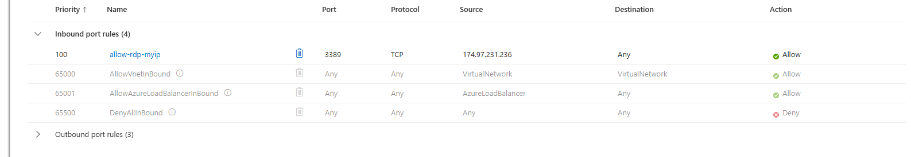
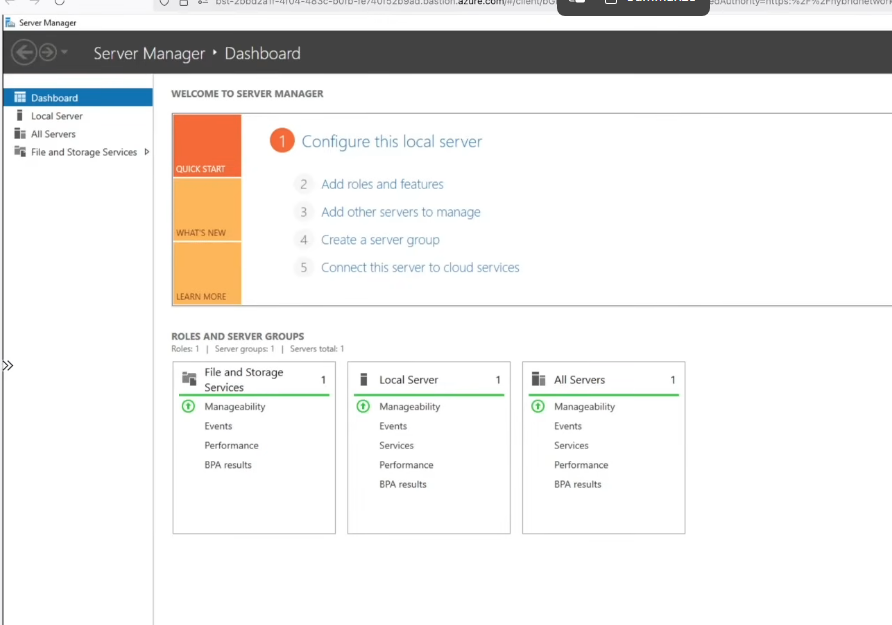
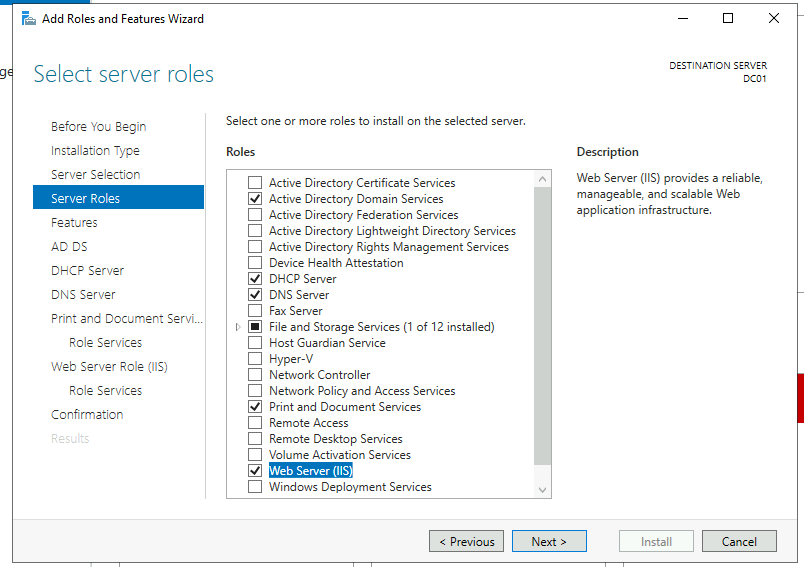
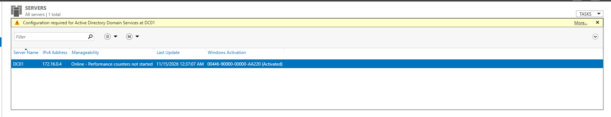
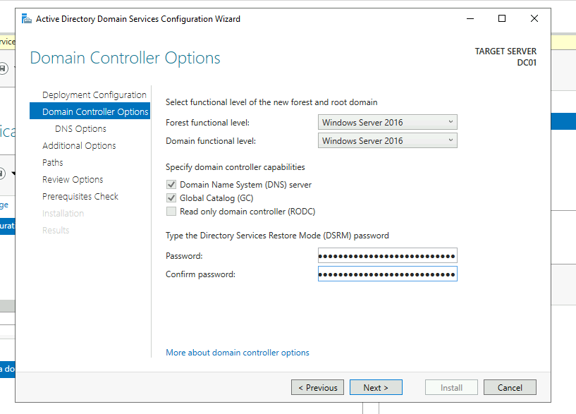
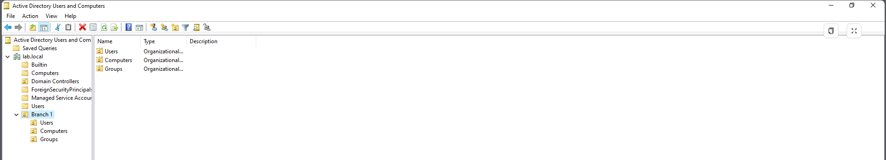

# AD-Home-Lab
Used Microsoft Azure to spin up a windows server 2022 VM to turn into a DC. Add another VM to join to the domain and test adding users, groups, and managing GPO.
Used the optimal setting in Azure to spin up a windows server 2022 VM to turn into my DC.

After this I setup a local admin account to log into, and disabled RDP (temp) for security reasons and I will be using Azure Bastion to connect

I then configured the virtual network and subnet my VM would run on, as well as the public ip

Configured the VM disk to be an SSD for better performance and made sure to check "delete with VM" (though I will be deleting the entire RG at the end of the lab)

That concluded my configuration for the VM so I spung it up.
Once it was up, I went to network settings to now allow RDP connection to only my IP

As this server is going to be my DC, DHCP, and DNS server, I gave it a static IP to avoid it potentially changing and breaking the lab

I then used Azure Bastion and RDP'd into my windows server VM

Upon getting into the windows server VM, server manager was opened automatically 

I then added all the roles and features needed to complete this lab including AD domain services, DNS, DHCP, Print server, Group Policy management, and Web server(IIS)

After this I rebooted the server as needed for these changes to take effect, used Azure Bastion to RDP in like last time
I then went to server manager and into AD DS to turn my server into my DC

I created a new forest with the root domain name "lab.local"

Configured my domain controller options making sure to use a strong password

I left the rest of the setting default and finished the install which rebooted my VM. I connected via bastion again and went to active directory users and computers and created a new OU called "branch 1"

Within "branch 1" I created 3 more OU's "users" "computers" "groups" to further organize my lab

I then added my first user to the "users" OU

